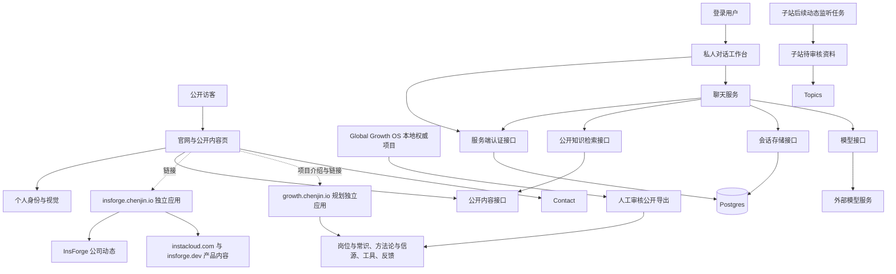

# chenjin.io 架构基线 V1

日期：2026-10-07。状态：本地架构候选版，构建、访问边界与页面预览已验证；后端尚未接入，未发布上线。

## 目标与当前考量

chenjin.io 是陈今长期拥有的个人 IP 官网，也是访客调用公开内容、发起对话与建立联系的入口。职业或公司变化只更新公开身份与案例，不改变站点所有权和账号关系。

| 用户考量 | V1 决策 | 落点 |
| --- | --- | --- |
| 个人 IP 必须明确 | Hero 保留姓名、个人定位、介绍和照片 | `features/identity` |
| 舍不得原版动态效果 | 保留绿青渐变，在稳定介绍旁加入轮换主题；支持减少动画偏好 | `ProfileHero` 与 `GradientMesh` |
| 全站行动入口要少 | 转化意图限定为对话、Contact；写作和项目是普通导航 | `features/site/config.ts` |
| 官网保持多页 | 写作、项目、资源、合作、关于保留独立路由 | `app` |
| 需要登录与数据库 | 私人工作台单独位于 `/app`，由服务端会话保护 | `features/auth` 与 `features/chat` |
| 下次回来能继续聊 | 账号聊天保存在数据库，通过账号跨设备读取 | V1 后端接入阶段 |
| InsForge 公司及两个产品的用户资源 | `insforge.chenjin.io` 区分公司动态、instacloud.com 与 insforge.dev | `sites/insforge` |
| Global Growth OS 独立用户入口 | 保留品牌，采用 `growth.chenjin.io`；主站保留项目介绍和个人复盘 | `sites/growth`（设计与配置；应用待实现） |
| 后续可能有不同专题或网站 | 专题站独立目录与应用，通过链接和公开接口连接主站 | 主站与子站边界 |
| 本地、GitHub、上线不一致 | Git 管源码，InstaCloud 管运行环境；每次发布记录提交与环境 | 发布流程 |

“稳定”指模块职责和接口可持续使用。新增能力与安全更新仍会发生；通过边界检查和兼容迁移控制影响范围，不能承诺以后完全不改代码。

## 一个应用内的模块划分

主站采用模块化单体：一个 Next.js 应用，使用 Postgres 存储账号相关数据。InsForge 采用另一个独立 Next.js 应用。Global Growth OS 规划为第三个独立 Next.js 应用，当前仅建立设计与公开配置。三个站点在同一 Git 仓库管理，各自构建和部署。每个应用内部暂不拆微服务。



路由负责装配各模块。聊天显示组件调用 HTTP 接口，身份模块不调用数据库，专题页面不直接执行监听任务。

| 模块 | 负责什么 | 不应直接依赖什么 |
| --- | --- | --- |
| identity | 公开姓名、定位、照片、联系资料与 Hero | 会话、数据库、模型供应商 |
| site | 站点 URL、导航、两类行动意图 | 用户表、聊天记录 |
| content | 发布筛选、文章卡片、公开知识投影 | 用户会话、公司内部资料 |
| sites/insforge | 公司动态、两个产品的用户内容与后续监听 | 主站页面、账号记录、私人聊天 |
| sites/growth（待实现应用） | Global Growth OS 公开方法、信源、工具与反馈入口 | 私有增长工作区、公司执行资产、其他站点业务代码 |
| auth | 验证会话并返回稳定的用户身份 | 首页结构、文章分类、模型选择 |
| chat | 消息与来源、会话权限、回答和存储接口 | 具体首页布局、厂商 SDK |
| infrastructure（后续） | Postgres、认证库、模型与邮件的适配器 | 页面组件与浏览器状态 |
| app | 页面/API 装配、路由元数据、鉴权入口 | 原始私人资料目录 |

跨模块交换数据使用明确的 contracts 类型。原有 `content`、`roadmap` 数据暂由 `public.server.ts` 聚合，属于过渡适配层；不要求一次迁移所有旧代码。V1 的检查范围覆盖新模块的运行时依赖，以及全站客户端对服务端源文件的传递依赖。

## 页面与访问规则

| 路由 | 用途 | 是否公开 | 搜索收录 |
| --- | --- | --- | --- |
| `/` | 个人介绍、照片、动态主题、对话入口与 Contact | 是 | 是 |
| `/writing/*` | 文章、手册与标签 | 已发布内容 | 是 |
| `/projects/*` | 项目与案例 | 已审核内容 | 是 |
| `/resources/*` | 工具、书架、推荐资源 | 是 | 是 |
| `/lab/*` | 自建工具 | 按工具能力决定 | 公开页可收录 |
| `insforge.chenjin.io` | 独立专题应用的正式域名，尚未上线 | 计划公开 | 内容上线后单独配置 |
| `/insforge` | 临时域名建设说明；子站上线后改为跳转 | 是 | 否 |
| `growth.chenjin.io` | Global Growth OS 独立用户站，应用与域名待接入 | 计划公开 | 内容上线后独立配置 |
| `/projects/global-growth-os` | 项目介绍、陈今的贡献与个人复盘；上线后链接用户站 | 是 | 是 |
| `/work-with-me` | 能力与合作说明，最终进入 Contact | 是 | 是 |
| `/about` | 经历、工作方式与背景 | 是 | 是 |
| `/chat` | 当前公开内容查询演示；后续作为正式聊天入口 | 是 | 当前保留 |
| `/login` | 登录入口 | 是 | 否 |
| `/app`、`/app/chat` | 私人工作台与历史对话 | 要求真实会话 | 否 |
| `/api/public/knowledge` | 无状态公开内容查询 | 是 | 否 |
| `/api/chat/*`（后续） | 创建、读取、删除个人会话 | 每个 API 独立鉴权 | 否 |
| `/account` | 旧账号占位页，后续兼容跳转至工作台设置 | 当前公开占位 | 否 |

公开官网保持 `/`。正式认证完成后，登录成功默认进入 `/app/chat`；工作台提供返回官网入口。用户主动访问 `/` 仍可查看个人官网。私人工作台不能因登录状态影响官网正文和搜索输出。

目前 `/app` 的认证适配器返回 unavailable，所有私人页面重定向至 `/login`。登录页明确说明尚未接入，不能收集密码或伪装登录成功。后续 API 必须各自调用认证接口，页面 layout 的保护不能代替 API 鉴权。

## Hero 和行动入口

Hero 使用稳定的个人介绍建立身份，轮换主题展示能力范围。渐变背景独立于身份配置，也独立于聊天组件。

首页撤下原有“看我怎么拆解问题”和“看我正在做什么”按钮，保留对话入口。Contact 在导航与底部可达。普通文章链接和项目链接属于内容发现路径，不增加第三种转化意图。

手机端通过菜单提供完整导航。减少动画设置启用后停止轮换，文字仍可读取。

首页最新文章从服务端的已发布列表生成，不再维护第二份标题和日期。

## 内容的公开边界

Markdown 与文章元数据继续随 Git 版本管理；账号聊天进入数据库。文章发布不要求修改用户表，账号功能变动也不改变文章的 canonical URL。

内容规则如下。

1. 文章正文与全量源数据标记为 server-only，客户端只能接收已发布的数据投影。
2. 写作列表和首页仅接收文章卡片，不携带正文或编辑备注。
3. 聊天检索只读取公开 Registry。草稿不进入推荐结果、站点地图或公开检索。
4. 私人 Life OS、原始聊天与公司内部文件不进入部署镜像或知识检索。
5. 发布状态改变后必须重新生成公开页面、RSS 和知识索引。撤回内容必须同步清理检索缓存。
6. `unlisted` 是否允许直接访问，需要未来单独定义；当前与草稿一起排除于公开查询。

本次修复了 Registry 的草稿筛选和失效的 `/#about` 链接。旧数据中没有 status 的文章仍按既有 published 规则处理，缺少完整日期的条目排除。后续内容录入应要求显式发布状态。

## 数据与账号职责

认证方案通过 `SessionReader` 接入。认证库自行维护其用户和会话表，业务代码只使用经服务端验证的 user.id。具体登录方式与邮件供应商在后端接入时确定，不能自行实现密码加密或凭证验证。

| 数据 | 拥有模块 | 关键字段/关系 | 状态 |
| --- | --- | --- | --- |
| user、session、account、verification | auth 适配器 | 认证库定义；稳定 user.id | 待接入 |
| conversation | chat | id、owner_id、title、created_at、updated_at | 接口已定义，待迁移文件 |
| message | chat | id、conversation_id、role、content、created_at | 接口已定义，待迁移文件 |
| message_source | chat | message_id、公开内容 ID、内容版本、URL | 数据设计，待实现 |
| topic/source/update | monitoring（后续） | 来源 URL、原始时间、审核状态、发布时间 | 暂不建表 |
| article/project/resource | content | Git 中的公开资产与稳定 ID | 已有数据 |

聊天数据约束如下。

- 所有读写方法都接受 ownerId；ownerId 取自服务端会话，禁止信任客户端传来的 ownerId。
- messages 与 append 也要验证所属会话，不能只在会话列表验证。
- 数据库查询同时限定 owner_id 和 conversation_id，使用外键约束消息与会话关系。
- 同一账号跨设备读取同一份记录。数据库备份与恢复演练必须在正式留存记录前完成。
- 保存访客消息后再请求模型，记录生成状态与失败状态；重试通过 request ID 去重。
- 删除会话必须覆盖消息及其来源关系；正式保留周期需在上线前确定，暂不承诺 30 天自动删除。
- 公开内容查询演示不持久化个人消息。后续正式聊天需要登录后才能保存和同步。

`ConversationRepository` 与 `AnswerProvider` 已定义，但本版没有存储实现、模型调用或可用账号。接口文件不等于数据库已建好。

## 公开对话转为私人会话的目标契约

V4 的目标流程为公开查询、临时保留、认证、确认保存、私人工作台。当前实现尚未接入临时存储和导入接口。界面及错误恢复定义保存在 `.design/site-architecture/INTERACTION_SPEC.md`。

公开对话的临时副本归浏览器公开对话模块管理，暂存键只包含公开对话及输入草稿。它与私人会话存储分开，不扩大主站 cookie 范围。浏览器临时存储不能替代账号数据库；存储不可用时提供复制内容的退出路径。正式实现前确定清理时限并写入隐私说明。

认证完成后，界面显示当前账号和待保存内容；用户确认后才调用导入接口。服务端从真实会话取 ownerId，以导入请求标识去重，原始回答保留来源和生成类型，不冒充重新验证的模型回答。导入成功后才清除临时副本；失败保留并允许原位重试。取消登录、取消导入和认证尚未接入均返回原公开查询状态。

私人会话失效后停止 API 读写，保留未提交草稿。重新登录为同一账号才恢复原会话；切换账号不得导入前一账号的私人消息。后续开发需单独验证导入重复请求、登录取消、不同账号隔离、保存失败和同账号恢复。

## 独立专题站与动态监听

InsForge 的正式地址确定为 `https://insforge.chenjin.io`。子站位于 `sites/insforge`，有自己的 Next.js 页面、构建配置和发布流程。主站只维护公开的子站地址与状态，不导入子站页面。

InsForge 是公司名，instacloud.com 与 insforge.dev 是旗下两个产品。子站面向两个产品的用户，负责公司与产品动态、应用用例与使用实践。公司级团队动态统一记录；每条产品内容指定所属产品，两者共用的内容可关联两个产品，正文仍保留一个 canonical 页面。当前预览在两个产品下均展示“产品与团队动态”栏目，统一公司动态页与内容库尚未实现。内容应帮助用户完成实际使用任务，说明适用场景、步骤和验证状态。陈今的 Launch Week 1 增长复盘及个人职业案例只保留在主站 `/projects/[slug]`，子站不收录这些内容，也不导流个人咨询。未来交换公开内容时遵循子站受众与内容规则，不能通过跨目录读取私人源文件。

后续监听链路为“获取来源 → 去重并保存待审核资料 → 审核 → 发布至子站”。监听器属于子站的服务端任务模块，子站自己的内容数据与主站聊天记录分开管理。预览分支不能触发生产监听任务。

同一 InstaCloud 项目规划 compute/web、compute/insforge 与 compute/growth，分别对应主站和两个子站。共享视觉资产以后提取为纯样式或无业务依赖的组件包；主站路由和账号逻辑不能成为子站构建依赖。具体监控数据服务在子站后端接入时创建。

主站登录 cookie 默认限定当前主机，子站不读取主站私人会话。需要跨站登录时再定义认证接口，不能直接把 cookie 扩展到所有子域名。

`/insforge` 当前只显示建设说明并设置 noindex，从主站 sitemap 中移除。子站正式上线并完成实际请求验证后，才把该路径改为永久跳转。两站分别管理 canonical 和 sitemap；当前子站架构预览也暂不允许索引。

域名尚未配置 DNS，云应用服务也未部署。代码目录建立与域名上线分别验收。

## Global Growth OS 独立用户站

2026-10-07，用户确认保留 Global Growth OS 品牌，独立用户站采用 `https://growth.chenjin.io`。`global-growth-os.chenjin.io` 仅为可选兼容地址，当前不创建、不绑定；将来启用后永久跳转至 growth.chenjin.io，不承载第二份内容。

| 入口 | 职责 |
| --- | --- |
| chenjin.io/projects/global-growth-os | 项目背景、陈今的贡献和个人复盘；用户站上线后提供链接 |
| growth.chenjin.io | 面向使用者的公开方法与工具，提供信源和反馈入口 |
| Global Growth OS 本地权威项目 | 完整系统设计、源材料、运行与评估记录 |
| GitHub 与飞书 | 按各自发布流程提供源码贡献及文档协作；同步状态分别核验 |

独立用户站第一阶段沿用已确认的四层公开策略。

| 栏目 | 第一阶段内容 |
| --- | --- |
| 岗位与常识 | 增长岗位、基础知识与工具平台 |
| 方法论与信源 | 研究方法、公开信源与深挖模板 |
| Growth Toolkit | 可复用模板、脚本和工作流 |
| 反馈与共创 | 反馈入口、活动与迭代记录；持续社区机制需另行验证 |

本地项目权威目录为 `/Users/jinchen/01-global-growth-system/projects/global-growth-os`。完整 OS 设计保留在该项目中，第一阶段仅发布经审核的四层 Public Core 内容。网站实现放在 chenjin.io 仓库的 sites/growth；文章与工具的来源仍由原项目管理。部署构建不得直接读取 01 私有工作区。

公开资料按“原项目准备 → 人工审核与脱敏 → 导出公开副本及来源清单 → 网站构建与发布”进入用户站。每项资料记录稳定 ID、来源路径或公开 URL、版本与发布状态。网站样式和路由由 sites/growth 管理，方法和工具的源材料由原项目管理，不在两个位置各自编辑同一份原稿。上线前需验证至少一次完整导出与发布；目前不声称已自动同步。

Global Growth OS 通用方法放在 growth.chenjin.io，InsForge 产品使用指南放在 insforge.chenjin.io，个人复盘放在主站。跨站使用链接与摘要；相同正文指定一个发布站点和 canonical 地址。公开工具若需要服务端能力，只增加该站点所需的接口，不依赖主站页面或聊天模块。

第一阶段不要求独立登录或数据库。反馈沿用已核验、适合公开的外部入口；账号与保存运行记录有明确用户需求后再设计。未来身份及业务数据按站点隔离，共享登录需通过明确的认证接口接入。

sites/growth 当前只包含设计说明与 site.json，没有 Next.js 应用、开发端口或可用预览。compute/growth 尚属部署规划，本次不创建云服务或 DNS 记录。后续实现独立应用后，依次验证构建、公开内容过滤、服务 URL，再绑定域名并更新主站链接。

### 品牌与搜索内容

品牌为 Global Growth OS，中文说明采用“面向全球市场的增长方法、研究信源与 AI 工作流”。域名用于提供简短入口；内容选题围绕 Growth Marketing、Go-to-Market 与 Marketing Automation 展开。AI Marketing 可作为内容方向，GTM Engineering 暂不作为全站主定位。

2026-10-07 的 Google Trends 研究采用全球、过去 12 个月、网页搜索及搜索词比较。下载数据存放在 `/Users/jinchen/02-personal-ip-system/outputs/2026-10-07-growth-keyword-research/`。Global Growth OS 品牌词在第一组比较中平均兴趣低于 1。Trends 的指数不能当作月搜索量或竞争难度；长尾关键词仍需验证，不以本次趋势结果保证排名或流量。

候选内容包括 go to market strategy template、growth experiment template、AI marketing workflows 和 competitor research template。每篇文章只有公开正文可供索引；完整 OS 内部设计不因关键词研究进入网站。

## InstaCloud 与发布流程

已创建项目 `chenjin-io`，ID 为 `19a8b5d7-136e-43c1-b1cf-86d9b0579384`。本次工作使用独立云分支 `architecture-v1`；`main` 保留。

- 此前架构阶段未创建应用服务、数据库或公开预览 URL；本次只更新设计，不改变云资源。主站与 InsForge 的 Dockerfile 和 Next standalone 配置已准备，Growth 应用与部署配置待实现。
- 后端接入时在开发分支创建 compute/web 与 postgres/db，显式绑定 DATABASE_URL。
- 有上传需求后才增加对象存储，避免首页照片与文章被迫改成数据库管理。
- GitHub 是版本分发入口，当前本地未提交改动仍须保存并进入明确 Git 分支后才能发布。
- 云分支复制环境不等于 Git 代码已提交，也不意味着数据库数据会自动合并。
- 模型与邮件密钥只保存在服务端 Secrets，禁止出现在 NEXT_PUBLIC 变量或镜像里。
- 每次发布记录 Git 提交、构建结果、迁移编号、云分支和实际验证 URL。当前无这些证据的旧版本不得称为统一完成。

生产切换按“保存版本 → 开发分支验证 → 兼容数据库迁移 → 部署 → 实际请求验证 → 域名切换”执行。数据库采用有版本号的迁移文件，使用先扩展再清理的兼容过程。生产数据不会通过分支 merge 自动合并，重要测试资料需显式迁出。

## 修改影响范围与验收

| 后续变化 | 正常修改范围 | 回归重点 |
| --- | --- | --- |
| 更换职业定位或照片 | identity 配置与展示 | Hero、联系资料、Person 元数据 |
| 调整首屏视觉 | identity 组件与视觉组件 | 手机布局、动画偏好、两类行动入口 |
| 发布一篇文章 | content 数据与正文 | 发布筛选、页面、首页、知识查询、SEO |
| 新增独立专题站 | sites 中的应用、子站元数据与独立部署配置 | 独立构建、公开链接、正文不重复 |
| 更换模型供应商 | AnswerProvider 的服务端适配器 | 回答、来源、超时、失败与用量限制 |
| 更换登录方式 | auth 适配器与登录页 | 会话、跨设备、退出与会话撤销 |
| 更换部署平台 | Docker/Secrets/发布配置 | 运行端口、迁移、域名与健康请求 |
| 接入监控任务 | monitoring 模块与任务配置 | 去重、审核、分支任务隔离 |

以下检查是 V1 的持续约束。

```sh
npm run check:architecture
npm run build
```

架构检查遍历 TypeScript/JavaScript 导入图，拒绝客户端传递导入 server-only 源文件或 raw 正文，拒绝受控功能模块之间的运行时导入，也拒绝子站直接导入另一个子站的业务实现。跨模块类型接口允许引用。新增例外需要记录原因、范围与移除条件。

以后涉及路由或数据接口的不兼容变化，需要更新这份基线及迁移记录。视觉调整、内容新增与供应商适配器替换不应顺便重排全站目录。

## 当前完成与下一步

已完成：模块契约；公开内容服务端边界；首页身份与动画模块；两类行动入口；手机导航；InsForge 独立子站骨架；私人工作台的关闭式访问保护；InstaCloud 独立分支；容器部署配置；依赖边界检查。

接下来按三个可验收阶段推进。

1. 接入 Postgres 与真实认证。验证登录、退出、会话失效、跨设备和不同账号隔离；保存聊天前确定保留政策并完成备份验证。
2. 接入会话存储和模型。完成消息留存、失败重试、来源引用、删除、限流与用量控制。关闭私人页面的行为自动采集与会话录屏。
3. 完成 SEO 和发布统一。补齐 RSS、文章 JSON-LD、社交元数据，以及隐私和服务条款的占位内容；确认生产部署对应明确 Git 提交后切换域名。

Growth 用户站单独按“公开资料导出 → 独立应用 → 构建与服务验证 → 域名绑定”实施，第一阶段不依赖主站认证接入。

本版的查询仍是规则匹配，登录页仍是未接入说明。原有 Roadmap 登录弹窗和账号页仍是旧占位功能，纳入第一阶段替换，不能作为认证完成的证据。

## 本次验证记录

- Next.js 生产构建通过，生成 54 个静态页面；原有图片组件保留 2 条 lint warning。
- 首次 V1 架构检查覆盖 99 个源文件。注入客户端间接加载服务端源文件、identity 运行时依赖 chat 两类错误，均被拒绝；测试文件已清理。
- 首次 V1 验证中 `/`、写作、新文章、原专题页与登录说明页实际请求返回 200；专题现已按用户指定改为独立子域应用。
- `/app` 与 `/app/chat` 均重定向至登录说明页；草稿文章实际请求返回 404。
- 公开查询排除草稿；无效输入返回 400，超出正文大小限制返回 413。
- 首次 V1 sitemap 验证为 44 个唯一公开 URL；子域修正后移除 `/insforge`，主站已验证为 43 个，子站正式发布前独立补齐 sitemap。
- 浏览器验证个人介绍、照片、查询结果和手机菜单开启；客户端构建文件未检出草稿文章 ID。
- 本地生产预览为 `http://127.0.0.1:8084/`。InstaCloud 分支 active，无 compute 或数据库服务；线上域名未切换。

## 子域修正记录

2026-10-07，用户明确指定 `insforge.chenjin.io`。本次将独立子域作为架构决定，覆盖此前主站 `/insforge` 聚合页的默认选择。新增 `sites/insforge` 应用目录，主站只引用其中公开的 site.json 配置；根目录类型检查与主站部署排除子站源码。主站与子站分别构建通过，架构检查也包含两站互相导入业务源码的限制。

## 子站受众修正记录

2026-10-07，用户明确子站服务 InsForge 用户。已移除 Launch Week 1 个人增长复盘及个人联系入口；页面、元数据和内容录入规则统一围绕产品使用。主站保留个人 IP 与增长项目。子站后续资料包括产品更新、使用用例、实施指南，以及最佳实践和排错内容；每项资料需有可核验来源与验证状态。

## Global Growth OS 架构确认记录

2026-10-07，新增 growth.chenjin.io 的站点职责、四层公开内容、来源与导出边界，以及独立部署规划。同步 InsForge 公司与两个产品的层级。主站项目页移除“以后才考虑独立域名”的旧说明。Growth 站点配置只登记设计，不代表应用、自动同步或云服务已完成。

## 依据

- 当前会话中已确认的照片与个人介绍、轮换效果、对话和 Contact、数据库与登录要求。
- `docs/strategy/2026-08-17-chenjin-io-personal-site-system-definition.md` 的个人归属与公开资料边界；页面/CTA 的旧决定以当前会话为准。
- 当前 Next.js 代码与此前 InstaCloud CLI 返回的项目、分支状态；本次未重新查询云资源。
- Global Growth OS 的 project.md、public-core/README.md 和 2026-09-13 四层公开策略。
- 当前会话确认的 Growth 独立用户站、品牌与域名决定。
- `README.md` 的内容、工具、资源、独立产品分类。旧 SPEC/ROADMAP 中的 Vite 描述保留作历史资料。
